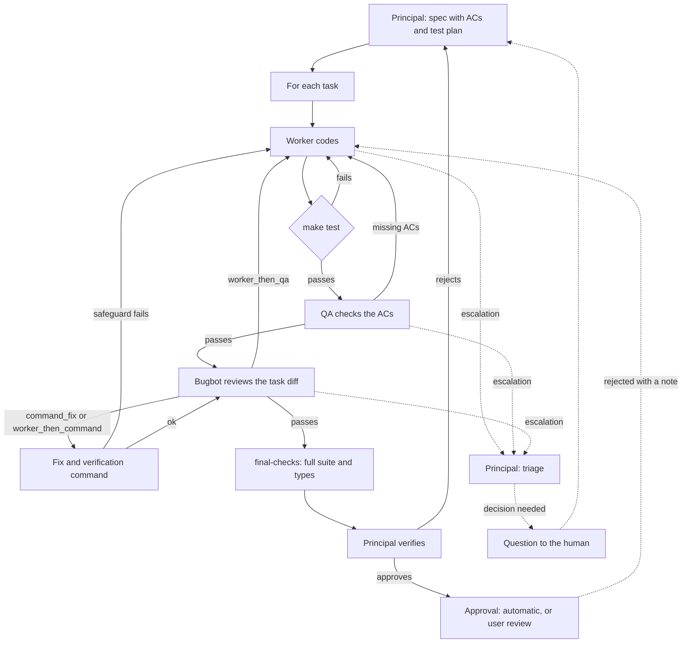

# Multi-provider orchestration harness for VS Code

Design and implementation plan. Version 1, November 2, 2026.

## Summary

A VS Code extension with the experience of a Claude Code-style coding agent (inline diffs, checkpoints, terminal) that also:

- talks to several AI providers (Anthropic, OpenAI, OpenRouter, DeepSeek) and to local servers exposed by other apps (Jan, Ollama, LM Studio, llama.cpp, vLLM);
- splits the work into roles: a **principal** (the most capable model) that investigates and writes the spec, **workers** that code specific tasks, **QA** that checks the acceptance criteria, and a **bugbot** that reviews the diff;
- picks the model for each task with a **user-configurable router**;
- adds determinism through **commands** (`make test`, lint, type checks) that deliver the verdict, and **bounded loops** that retry without running away;
- stops loops when a business inconsistency or an open decision shows up, and has the principal resolve it with a human (**escalation**);
- is configured visually: providers, favorites, routing rules, and a **block-based flow editor**, all saved with one button and selectable per session.

The central piece is **one configuration schema**: the visual screens and the YAML files are two views of the same data.

---

## 1. Goals and scope

### Goals

1. Users add providers and models without writing code.
2. Users define routing rules: which parameters send a task to which model, with which fallback.
3. Users edit the orchestration flow as blocks and save it on their machine or in the project.
4. Each conversation picks which orchestration to use.
5. The chat shows live how subtasks progress, what waits on what, and why.
6. Any AI step can be followed by a deterministic check run by a command.
7. Every loop is guaranteed to end.
8. Business decisions are made by a human, never by a model guessing.

### Out of scope

- Running models inside the extension. Local models are served by another app; the extension is only a client.
- Combining several people's accounts or credentials, or rotating accounts to add up limits (see section 2).
- Using consumer subscriptions (Claude Pro/Max) inside the extension.
- Gemini support, for now.
- Making money: the project is free and open source.
- Telemetry: no data leaves the user's machine except the requests to the providers the user configured.

---

## 2. Terms of service constraints

Review of the official terms done on November 2, 2026. **This is not legal advice.** The project is free and open source, with no commercial use planned. If it is ever monetized, two things change: Sign in with ChatGPT needs OpenAI's approval, and someone from legal should review this section.

| Provider | Several keys in one organization | Several own accounts to add up limits | Subscription (OAuth) in a third-party extension | Sharing credentials between people |
|---|---|---|---|---|
| Anthropic | Allowed, but adds no capacity | Prohibited (reading of "bypass… restrictions") | Explicitly prohibited | Prohibited |
| OpenAI | Allowed, but adds no capacity | Explicitly prohibited ("circumvent any rate limits") | Only through the official "Sign in with ChatGPT" flow | Prohibited |
| DeepSeek | Allowed, but adds no capacity | Not addressed directly; bulk registration is prohibited | Not applicable | Prohibited |
| OpenRouter | Allowed, but adds no capacity | Explicitly prohibited | Not applicable; multi-key BYOK is allowed | Prohibited except as users of an organization |
| Gemini | Allowed, but adds no capacity | Explicitly prohibited | Explicitly prohibited | Prohibited |

Usage limits apply per organization, account, or project, not per key. OpenAI, Anthropic, and OpenRouter also prohibit helping or allowing others to break their terms, so an "add up accounts" feature exposes the extension's author too.

Main sources:
- [Anthropic Usage Policy](https://www.anthropic.com/legal/aup) and [Claude Code legal](https://code.claude.com/docs/en/legal-and-compliance)
- [OpenAI Terms of Use](https://openai.com/policies/row-terms-of-use/), [Services Agreement](https://openai.com/policies/services-agreement/), and [Sign in with ChatGPT](https://developers.openai.com/siwc/quickstart)
- [DeepSeek Open Platform Terms](https://cdn.deepseek.com/policies/en-US/deepseek-open-platform-terms-of-service.html)
- [OpenRouter Terms](https://openrouter.ai/terms)
- [Gemini API Additional Terms](https://ai.google.dev/gemini-api/terms)

### Design consequences

- **Credential profiles, not a rotating pool.** Up to 3 profiles per provider, each a real billing context owned by the user (for example personal and work). The user picks the active one; the extension never rotates between them to get around a provider's limits.
- **Fallback on provider limits jumps between providers and models, never between accounts of the same provider.** On a 429 the extension honors `Retry-After` and moves to the next model in the chain, skipping links that are another profile of the same provider.
- **Another profile as a budget backup.** A user may put the same model on another of their own profiles in a chain (for example personal, then work). That link is only used when the user's own session budget for the first profile runs out (section 11), never in response to a provider's rate or usage limit.
- **Shared access only through official channels:** API organizations, ChatGPT Business, or OpenRouter organizations.
- **Subscriptions:**
  - Anthropic and Google: API keys only inside the extension.
  - OpenAI: integrate "Sign in with ChatGPT" with our own client registration, which is free for open-source projects like this one.
  - Alternative: run the official, unmodified CLI (for example `codex exec`) as a subprocess, with the user's own session.
- **Legitimate ways to give users more capacity:** delegating to local and cheap models, cross-provider fallback, prompt caching, trimmed context, higher usage tiers, and requesting a capacity increase from DeepSeek.

---

## 3. Overall architecture

### Base: a fork of Zoo Code

Status of the candidates as of November 2026:

- **Roo Code** shut down on May 15, 2026; its repository is archived and gets no fixes.
- **Kilo Code** was rebuilt on the OpenCode server: the VS Code extension is now a thin client over a bundled `kilo serve` process that owns the agent loop, tools, permissions, and sessions, and its webview uses Solid.js.
- **Cline** moved its VS Code extension onto the Cline SDK (August 2026), an editor-agnostic runtime shared with its CLI and desktop app.
- **Zoo Code** is the community fork of Roo Code (Apache 2.0, active releases). It keeps Roo's architecture: the agent loop runs inside the VS Code extension host and talks to VS Code APIs directly.

Zoo Code is the one most tightly bound to VS Code, so it is the base. It already ships:
- a React chat UI in a webview (React Flow fits in without a second UI framework) and an agent loop with tools;
- a diff view with accept/reject and checkpoints backed by a shadow git repo;
- terminal integration and MCP support;
- a provider layer (`src/api/providers`) and provider profiles;
- custom modes with a model profile per mode, an orchestrator with parallel subtasks, and a destructive command guard.

The risk is that it is maintained by a community team, not a company. Phase 0 confirms how much of it can be reused. Building all of that from scratch would take months.

### Layers

| Layer | Responsibility |
|---|---|
| UI (webview, React) | Chat, subtask view, configuration screen, block editor, per-session selector |
| Flow engine | Interprets the block graph: dependencies, conditions, loops, limits, escalations |
| Router | Picks the model for each task from rules; a pure function |
| Provider adapters | Translate to one internal format for messages, tools, streaming, and errors |
| Command runner | Runs commands in the task's worktree and extracts structured results |
| Configuration | Layered loading, JSON Schema validation, saving, secrets in SecretStorage |
| Event log | Emits the events consumed by the chat, the metrics, and the decision log; it is also the persisted session state used to resume (section 16) |

---

## 4. Providers

### Common interface

The engine never talks to a provider directly; it goes through an adapter.

```ts
interface ProviderAdapter {
  type: ProviderType;
  listModels(): Promise<ModelInfo[]>;          // id, context window, tool calling, pricing
  healthCheck(): Promise<Health>;               // online / offline / rate-limited until
  stream(req: ChatRequest, signal: AbortSignal): AsyncIterable<ChatEvent>;
}

type ChatEvent =
  | { type: "text"; delta: string }
  | { type: "tool_call"; id: string; name: string; args: unknown }
  | { type: "usage"; input: number; output: number; cached?: number }
  | { type: "error"; kind: "rate_limit" | "auth" | "context_length" | "unavailable"; retryAfterMs?: number };
```

Normalized errors are what let the router decide:

| Error | Reaction |
|---|---|
| `rate_limit` | Wait per `Retry-After` and move to the next model in the fallback chain, skipping other profiles of the same provider |
| `context_length` | Move to a model with a larger context window |
| `auth` | Tell the user; do not retry |
| `unavailable` | Mark the provider as down and move to the next one |

**Switching models in the middle of a task:** the next model resumes the same conversation (history, tool results, and the edits already made in the worktree). The interrupted attempt does not count against the loop, because it never finished.

For providers the fork does not already have, the [Vercel AI SDK](https://ai-sdk.dev/) handles normalization (Anthropic, OpenAI, DeepSeek, OpenAI-compatible, and OpenRouter).

### Adapter types

| Type | Endpoint | Authentication | Notes |
|---|---|---|---|
| `anthropic` | `POST https://api.anthropic.com/v1/messages` | `x-api-key` and `anthropic-version` headers | Native API for prompt caching and extended thinking |
| `openai` | `POST https://api.openai.com/v1/responses` | `Bearer` | Responses API; some Codex models only work with it |
| `openrouter` | `POST https://openrouter.ai/api/v1/chat/completions` | `Bearer`; optionally `HTTP-Referer` and `X-Title` | Catalog with context, pricing, and `supported_parameters` at `GET /api/v1/models` |
| `deepseek` | `https://api.deepseek.com`, OpenAI-compatible | `Bearer` | |
| `openai-compatible` | Configurable URL, `/v1/chat/completions` | Optional key | Local servers and anything else compatible |
| `cli` | Subprocess, for example `codex exec` | That CLI's own session | Uses the user's plan without touching their credentials. The harness does not restrict its tools; it runs in the task's worktree and is trusted to do its job. Its token usage may be unknown |

### Local servers exposed by another app

**Auto-discovery** when the extension starts and through the "Find local servers" command: `GET /v1/models` on each known port, with a timeout of about 300 ms.

| App | Default URL |
|---|---|
| Jan | `http://localhost:1337/v1` |
| Ollama | `http://localhost:11434/v1` |
| LM Studio | `http://localhost:1234/v1` |
| llama.cpp server | `http://localhost:8080/v1` |
| vLLM | `http://localhost:8000/v1` |

**Manual setup:** any URL, including another machine on the network (for example `http://192.168.1.20:1234/v1`), with an optional key.

**Capabilities:**
- The context window comes from `/v1/models` when the server reports it, or from `/api/show` on Ollama; otherwise the user sets it.
- Tool calling is detected with a test request that carries a dummy tool. The result is stored and the user can correct it.

**Models that change:** the model loaded in these apps can change at any time. The list is refreshed periodically and on every health check; a favorite that is no longer loaded is marked unavailable and the router skips it.

**Diff mode for models without tools:** the agent receives the files in the prompt and returns a unified diff, which the extension applies and validates. When the diff does not apply, the outcome depends on the role:
- worker: it uses up one attempt of its loop;
- QA (which only adds tests): the extra tests are discarded and the flow continues.

### Concurrency

- Local providers have a maximum number of simultaneous conversations, 1 by default. Few machines can run a decent model more than once at a time, which is why local models get light work.
- Cloud providers have a user-set maximum of parallel requests.
- A task whose model is at its limit waits for a free slot; the chat shows "waiting for a slot on Jan".

### Credential profiles

- Up to 3 profiles per provider, each with a label and a reference to a secret.
- Keys are stored in `context.secrets` (VS Code SecretStorage). Files only hold the secret's name.
- One active profile per provider, chosen by the user.
- Usage counter per profile, read from the rate-limit headers of each response (`anthropic-ratelimit-*`, `x-ratelimit-remaining-*`).

```yaml
providers:
  - id: anthropic
    type: anthropic
    profiles:                    # max 3; secrets live in SecretStorage
      - { label: Personal, secret: anthropic.personal }
      - { label: Work,     secret: anthropic.work }
    active_profile: Personal
    max_concurrent: 4            # parallel requests to this provider
  - id: openrouter
    type: openrouter
    profiles: [{ label: Personal, secret: openrouter.personal }]
    max_concurrent: 4
  - id: jan
    type: openai-compatible
    base_url: http://localhost:1337/v1
    local: true
    max_concurrent: 1            # default for local providers
  - id: ollama
    type: openai-compatible
    base_url: http://localhost:11434/v1
    local: true
  - id: codex
    type: cli
    command: codex exec
```

---

## 5. Models and favorites

OpenRouter has hundreds of models, so favorites are essential.

- Models are starred in the chat's model picker, and favorites are listed first.
- Each conversation remembers its model.
- Each favorite gets **roles**, which is what the router uses: `orchestrator`, `orchestrator-fallback`, `worker`, `reviewer`, `qa`, `short-tasks`.
- Capabilities (context window, tool calling, cost) are filled in automatically and can be corrected.
- A favorite can pin a credential profile with `@`: `anthropic/<claude-id>@Work` is the same model billed to the Work profile. Without `@`, the provider's active profile is used.

```yaml
models:
  - ref: anthropic/<claude-id>
    label: Claude
    roles: [orchestrator]
  - ref: anthropic/<claude-id>@Work
    label: Claude (Work)
    roles: [orchestrator-fallback]
  - ref: openrouter/anthropic/<claude-id>
    label: Claude (OpenRouter)
    roles: [orchestrator-fallback]
  - ref: openrouter/deepseek/deepseek-chat
    label: DeepSeek
    roles: [worker]
  - ref: openai/<gpt-id>
    label: GPT
    roles: [qa]
  - ref: codex/default
    label: Codex CLI
    roles: [reviewer]
  - ref: jan/qwen2.5-coder-7b
    label: Local Qwen
    roles: [short-tasks]
    context_window: 8192
    tool_calling: false
```

---

## 6. Router

### Parameters

These are the only fields a rule can match on. The principal fills in the ones that depend on what the task means; the engine computes the measurable ones.

| Parameter | Set by | Values | Meaning |
|---|---|---|---|
| `kind` | Principal | `rename`, `docstring`, `format`, `small-edit`, `feature`, `tests`, `refactor`, `review`, `research` | Type of work |
| `size` | Engine | `short`, `medium`, `large` | Computed from tokens and files using the thresholds |
| `est_tokens` | Engine | number | Estimated tokens of the context that will be sent |
| `files` | Engine | number | Files in the task's `edit` list |
| `paths` | Engine | glob patterns | Paths the task touches |
| `needs_tools` | Engine | yes or no | Whether the task requires tool calling |
| `role` | Flow | `orchestrator`, `worker`, `qa`, `reviewer`, `short-tasks` | Which flow step is asking for a model |
| `max_cost` | User | amount | Cap on estimated cost per task |

`est_tokens` is counted with the model's real tokenizer. When a model does not expose one, a character-based approximation is used instead.

### Pre-filter

Before applying any rule, the engine drops the models that cannot serve the task:
- offline, or waiting out a 429;
- with a context window smaller than `est_tokens` plus a margin;
- without tool calling when `needs_tools` is true (unless the role accepts diff mode);
- with an estimated cost above `max_cost`.

### Rules

An ordered list; the first match wins. Each rule names a model or a role, and a fallback chain.

```yaml
router:
  thresholds:                    # what "short" and "medium" mean, user-editable
    short:  { max_tokens: 4000,  max_files: 2 }
    medium: { max_tokens: 30000, max_files: 8 }
  rules:
    - name: Short tasks stay local
      when: { size: short, kind: [rename, docstring, format, small-edit] }
      use: jan/qwen2.5-coder-7b
      fallback: [openrouter/deepseek/deepseek-chat]
    - name: Private code stays local
      when: { paths: ["src/secrets/**"] }
      use: role:short-tasks
      fallback: [ollama/qwen2.5-coder-14b]
      stay_local: true           # the principal's model is not appended
    - name: Tests and refactors
      when: { kind: [tests, refactor], size: [short, medium] }
      use: role:worker
      fallback: [anthropic/<claude-id>]
  default:
    use: role:orchestrator
    fallback: [role:orchestrator-fallback]
```

### Model chain

The `use` model plus its `fallback` list form the task's **model chain**. The same chain serves two purposes:
- **Errors** (429, unavailable, context too small): the next model resumes the conversation (section 4).
- **Loop limits:** when a loop runs out of attempts (`on_exhausted: escalate_model`), the task moves to the next model in the chain, with its loop counters back at zero.
- **Budget limits:** when a profile's session budget runs out (section 11), the task moves to the next link, which may be the same model on another profile.

Rules for the chain:
- Every rule and every agent block must have at least one backup model. Save is rejected otherwise.
- The principal's model is the top of every chain and is appended at the end if missing.
- `stay_local: true` is optional and only applies when the user sets it. Such a chain may only contain models from providers marked `local: true` (save rejects anything else), and the principal's model is not appended.
- When the top of the chain also runs out, the task is escalated to the principal (section 13).

Because the chain is finite, a task cannot climb forever.

### Engine

- **Pure function:** `route(task, rules, catalog, state) → decision`. The decision holds the chosen model, the matching rule, the reason, and the fallback chain. It is fully covered by unit tests.
- **Health state:** periodic checks of local servers; after a 429, the provider waits out `Retry-After`.
- **Decision log** shown in the chat: "t3 → Local Qwen (rule: Short tasks stay local)".
- **Simulator** on the configuration screen: type a sample task and see which rule matches and which model would be used.

---

## 7. Roles

| Role | Default model | Tools | Produces |
|---|---|---|---|
| Principal | The most capable (`orchestrator`) | Read-only: read, search, web; `delegate`; escalation triage | Spec, spec deltas, final verification, decisions |
| Worker | Chosen by the router | Read; edit **only** the files in its `edit` list; run the task's commands; `raise_escalation` | Diff and notes |
| QA | Preferably different from the worker's (`qa`) | Read; edit **only** the test files of its task (those referenced in `test_plan`); run commands; `raise_escalation` | Result per acceptance criterion with evidence, added tests, and the cases the worker is missing |
| Bugbot | Preferably different from the worker's (`reviewer`), for example Codex | Reviews the task's diff (not restricted when it runs as a `cli` provider); `raise_escalation` | Classified findings (section 12) |

Principles:
- The principal does not edit code. That keeps token spend on the expensive model low and its context clean.
- The worker writes the tests. QA can add more tests in the same files and tells the worker which cases are not covered yet.
- QA and the bugbot preferably use models different from the worker's, so they do not share its blind spots. When no other model is available, the same one is used and the chat shows a warning.
- No agent invents business rules: when something is unclear, it escalates (section 13).

### Agent file format

A markdown file with frontmatter, the same format as Claude Code subagents:

```markdown
---
name: worker
tier: auto            # the router decides; or pin a favorite
tools: [read, edit, command, raise_escalation]
edit_scope: task      # may only edit the files listed in the task spec
---
You execute exactly one task spec. Edit only the files in `edit`.
Run the acceptance commands and report the diff and results.
If a business rule is unclear or contradictory, call raise_escalation instead of guessing.
```

---

## 8. Task spec

The contract between the principal and the workers. It is what makes cheap models reliable.

```yaml
spec_version: 1
tasks:
  - id: t3
    goal: Add retry to fetchOrders
    kind: feature
    edit: [src/api/orders.ts, src/api/orders.test.ts]   # the only files the worker may change
    read: [src/api/http.ts]                             # read-only context
    instructions: |
      Wrap the fetch call in withRetry from http.ts.
      Follow the pattern used in fetchCustomers.
    acceptance_criteria:
      - id: AC1
        text: Retries 429 and 5xx up to 3 times
        verify: test          # test | command | review
      - id: AC2
        text: Does not retry 4xx other than 429
        verify: test
    test_plan:
      - { covers: [AC1], test: "orders.test.ts > retries 429 and 5xx" }
      - { covers: [AC2], test: "orders.test.ts > does not retry 404" }
    acceptance:
      - npm test -- orders
    depends_on: [t1]
```

Rules:
- The extension **enforces** the `edit` list: any edit outside it is rejected.
- Each acceptance criterion has an id, so QA and the bugbot can refer to it.
- `test_plan` links each criterion to its tests. That is what lets a command verify that a fix did not break a criterion.
- The worker writes the tests in `test_plan`. QA may add tests to those same files; the tests it adds join `test_plan`.
- A task is done only when its `acceptance` commands **and** the flow's test command pass. When only one of the two exists, that one decides. Commands from the spec go through the same allowlist as any other (section 17).
- The spec is versioned. Every decision or rejection by the principal produces a new version.

---

## 9. Flow engine

The flow is a **graph of connected blocks**.

### Block types

| Block | `type` | Purpose |
|---|---|---|
| Agent | `agent` | Runs a role with its prompt |
| For each task | `foreach` | Runs the sub-sequence for every task in the spec; in parallel when they share no files |
| Command | `command` | Runs a command and produces a deterministic verdict (section 10) |
| Review | `review` | Review agent with findings routing (section 12) |
| Condition | `condition` | Picks a path based on an output |
| Loop | `loop` | Container that repeats its content until a condition, with limits (section 11) |
| Approval | `approval` | Final approval, automatic or by the user (section 14) |
| Subflow | `subflow` | Runs another reusable flow file |
| Script | `script` | External command that returns JSON, for custom integrations |

### Connections

- `after: [x]` means the block waits for `x`.
- `when` is the condition: `success`, `failure`, `always`, or an expression over outputs (`bugbot.needs_qa`).
- `join: all` (default) waits for every block in `after`; `join: any` starts as soon as the first one finishes.
- Each block declares its inputs and outputs; conditions can only reference existing outputs.

### Completion actions

Any block can trigger a command or a subflow when it finishes:

```yaml
- id: implement
  type: agent
  agent: worker
  on_finish:
    - when: success
      run_flow: flows/verify-python.yml   # reusable verification
    - when: always
      run: git diff --stat
```

### Parallelism

- Tasks that share no files in `edit` run in parallel, each in its own git worktree, up to the providers' concurrency limits (section 4).
- Each worktree gets its own environment (for example its own `.venv`), created by the project's setup command when the worktree is created:

  ```yaml
  worktree:
    setup: uv sync
  ```

- Tasks with `depends_on` wait for their dependencies.

### Session branch and worktrees

- Each session gets its own branch, `harness/<session-id>`, created from the user's current commit. The user's branch is never touched while the flow runs.
- A task's worktree is created from the session branch when the task starts, so a task with `depends_on` already contains its dependencies' work.
- When a task passes its bugbot loop, only the files in its `edit` list are committed (one commit per task) and merged into the session branch right away. Changes made by the setup command, such as a regenerated lock file, are not committed.
- Because parallel tasks never share `edit` files, a merge conflict should not happen. If one does, it is a `spec_conflict` escalation; no model resolves conflicts on its own.
- A worktree is deleted as soon as its task is merged. Worktrees of failed or paused tasks are kept for inspection until the session ends.
- In orchestrated mode, the per-task commits on the session branch are the checkpoints: undoing a task means reverting its commit. The fork's shadow-git checkpoints stay for single-agent mode and are not used inside worktrees.

---

## 10. Commands

The command delivers the verdict, not the AI: a worker cannot mark a task as done if its command fails.

```yaml
- id: tests
  type: command
  run: make test
  cwd: "{{task.worktree}}"
  timeout: 300s
  success_codes: [0]
  parse: junit:reports/junit.xml   # junit | json | regex | none
```

| Output | Content |
|---|---|
| `passed` | `true` when the exit code is in `success_codes` |
| `exit_code` | Exit code |
| `failures` | Extracted failures (test, message, trace), when `parse` is set |
| `output` | Output trimmed to the last N lines |
| `signature` | Fingerprint of the failures, used to detect lack of progress |

Available variables include `{{task.worktree}}`, `{{task.files}}`, `{{task.related_tests}}`, and `{{finding.files}}`. They let a command check only what was touched instead of the whole suite.

The model never receives the full log, only `failures` or, without a parser, the tail of `output`.

---

## 11. Loops and limits

### Loop semantics

```yaml
- id: test-loop
  type: loop
  max_iterations: 3              # repair attempts; there is always a final check after the last one
  reset: per_parent_iteration    # counter goes back to zero on each iteration of the enclosing loop
  budget: { max_tokens: 40000, max_minutes: 10 }
  stop_if_no_progress: true
  until: tests.passed
  on_exhausted: escalate_model   # escalate_model (default) | escalate_to_principal | fail | ask_user
  body:
    - { id: code,  type: agent,   agent: worker, feedback: [tests.failures] }
    - { id: tests, type: command, run: make test, parse: junit:reports/junit.xml }
```

1. The body runs. If `until` holds, the loop ends successfully.
2. Otherwise, the relevant output (`feedback`) goes back to the agent, and that counts as one attempt.
3. After the last attempt there is always a final check.
4. When attempts run out, `on_exhausted` applies. The default, `escalate_model`, moves the task's worker to the next model in its chain (section 6).

### Counter reset

With `reset: per_parent_iteration`, an inner loop's counter goes back to zero every time the enclosing loop starts a new iteration. For example, when QA sends work back to the worker, the worker gets all its test attempts again. Outer loops count their own iterations, so the total stays bounded.

### Limits at three levels

| Level | Limit | Where it is set |
|---|---|---|
| Loop | `max_iterations`, `budget.max_tokens`, `budget.max_minutes` | On the block |
| No progress | Stops if two consecutive iterations produce the same failure `signature` | `stop_if_no_progress` |
| Session | Tokens and cost per credential profile, and total time | Global configuration |

When a profile's session budget runs out, its tasks move to the next link in their model chain (section 6), which may be the same model on another of the user's profiles. When every link is out of budget, the task goes to the human.

When the session's time runs out, the default is the same: tasks move to the next link in their chain. With `on_time_exhausted: ask_user`, the session pauses instead and asks the user whether to continue.

### Global caps

No flow can exceed them; they are validated on save.

```yaml
limits:
  max_loop_iterations: 5          # a loop asking for more is rejected on save
  max_nested_loops: 4
  worst_case_warning: 20          # warn when worst-case worker runs per task exceed this
  max_escalations_per_task: 3
  max_human_questions_per_session: 5
  command_timeout_default: 300s
  session:
    max_minutes: 60
    on_time_exhausted: fallback   # fallback (default) | ask_user
    per_profile:                  # budget of each credential profile within one session
      max_tokens: 500000
      max_cost_usd: 5
```

### Worst case

The editor computes and shows the maximum number of worker runs per task by multiplying the maxima of the nested loops, and then by the length of the model chain. In the default flow: delivery 2 × bugbot 2 × QA 3 × tests 3 = **36** per model. In practice it is far fewer, because findings routing (section 12) avoids most QA rounds, and the session budget is the real cap.

---

## 12. Bugbot findings and their routing

### Scope

The bugbot runs **per task** and reviews only the diff of the worker that handed over the changes (the files in its `edit` list). Bugs that come from combining tasks are covered by the `final-checks` block and the principal's final verification.

### What it returns for each finding

```json
{
  "id": "F3",
  "severity": "medium",
  "category": "typecheck",
  "file": "src/api/orders.ts",
  "line": 42,
  "message": "withRetry returns Promise<unknown>, caller expects Order[]",
  "affects_ac": [],
  "behavior_change": false,
  "autofix": false
}
```

- `severity`: `high`, `medium`, `low`.
- `category`: `format`, `lint`, `typecheck`, `logic`, `security`, `performance`, `test-gap`.
- `affects_ac`: affected acceptance criteria.
- `behavior_change`: whether fixing it changes a key behavior.
- `autofix`: whether a command can fix it without intervention.

`behavior_change` comes from pluggable detectors behind one interface; a finding is marked `true` when any detector says so. The first version ships one detector, the bugbot's own claim, backed by the test safeguard below. Others, such as static analysis, can be added later without touching the routing.

### Routing table

The bugbot classifies; the route is chosen by a rule table in the configuration. That way the same finding always takes the same path, and users can tune it.

```yaml
findings_routing:
  - name: Auto-fixable format and lint
    when: { category: [format, lint], autofix: true }
    route: command_fix
    fix: "make fmt FILES='{{finding.files}}'"
    verify: "make lint FILES='{{finding.files}}'"

  - name: Types and lint with no behavior impact
    when: { category: [typecheck, lint], affects_ac: none, behavior_change: false }
    route: worker_then_command
    verify: "make typecheck && make test"

  - name: Minor with no impact
    when: { severity: low, affects_ac: none, behavior_change: false }
    route: report_only

  - default:
      route: worker_then_qa
```

| Route | Who fixes | Who verifies | Token cost |
|---|---|---|---|
| `command_fix` | A command (formatter, linter `--fix`) | A command | None |
| `worker_then_command` | The worker | A command (types and tests) | Worker only |
| `worker_then_qa` | The worker, going through its test loop | QA, then the bugbot again | Full |
| `report_only` | Nobody | Goes to the final report | None |

Commands are per project; `make fmt` and `make typecheck` are examples.

### Deterministic safeguard

After a `command_fix` or `worker_then_command` fix, the harness checks:
1. that the fix's diff stays within the finding's files and lines, plus a configurable margin;
2. that the acceptance criteria's tests (per `test_plan`) still pass.

If either check fails, the finding is **promoted** to `worker_then_qa`. No change that touches behavior skips QA.

### Order within one bugbot round

1. All `command_fix` findings.
2. One worker pass with all `worker_then_command` and `worker_then_qa` findings together.
3. Verification commands and the safeguard.
4. One QA run, only if any `worker_then_qa` finding remains.
5. The bugbot again.

If a round has no `worker_then_qa` findings, the QA loop is skipped.

### Outputs

| Output | Content |
|---|---|
| `bugbot.passed` | `true` when no findings are left other than `report_only` ones |
| `bugbot.needs_qa` | `true` when any `worker_then_qa` finding remains |
| `bugbot.routed_findings` | Findings sent to the worker, with their route |
| `bugbot.report_only` | Findings that go to the final report |

QA exposes `qa.passed` (every criterion met) and `qa.missing` (unmet criteria and uncovered cases).

---

## 13. Escalation: the loop breaker

A loop retries; an escalation stops the retrying, because more attempts do not fix a decision nobody has made.

### Flow

1. Any internal agent calls `raise_escalation`.
2. The harness pauses **only what is affected**: that task and its dependents. Everything else keeps going. The escalation does not consume loop attempts.
3. The principal always receives it first.
4. The principal decides:
   - **resolved without a human**: returns the spec change, citing where the answer was;
   - **rejected**: replies to the agent ("this is already in AC3") and the agent continues;
   - **ask the human**: 2 to 4 options, a recommendation, the impact of each option, and what is blocked.
5. The human answers in the chat.
6. The principal publishes a new spec version. Affected tasks resume with counters at zero; finished tasks that are not affected stay as they are.

### What the agent sends

```json
{
  "type": "decision_gap",
  "task": "t2",
  "raised_by": "qa",
  "summary": "AC2 says no retry on 4xx, but the partner API returns 409 for transient locks",
  "evidence": [{ "file": "docs/partner-api.md", "line": 88, "quote": "409: resource locked, retry later" }],
  "blocks": ["AC2"],
  "options_seen": ["Retry 409 as transient", "Keep AC2 as written and fail on 409"]
}
```

| Type | Meaning |
|---|---|
| `business_inconsistency` | Two business rules contradict each other |
| `decision_gap` | The spec does not say what to do in a case |
| `spec_conflict` | A criterion clashes with existing code, or tasks hit a merge conflict |
| `missing_info` | A piece of data only a person has is missing |
| `out_of_scope` | Completing the task requires touching something outside its `edit` list |

### Automatic escalations

| Signal | Why it points to an open decision |
|---|---|
| The model chain runs out | The task kept failing even on the principal's model (section 6) |
| `stop_if_no_progress` fires | The same failure repeats; the problem is probably not the code |
| QA–worker ping-pong | The same criterion fails in two QA rounds with opposite fixes |
| QA and bugbot contradict each other | One asks for what the other rejects |

### Limits

- Maximum escalations per task (3 by default). When reached, the task goes to the human.
- Maximum human questions per session. Non-blocking questions are batched. Once the cap is reached, new questions are no longer notified one by one: they are collected in a single list, and the tasks they block stay paused while everything else continues.
- Escalation metrics per model, to spot workers that escalate too often.

### Messages from the user during a run

They go to the principal, which decides whether to stop the whole flow or keep it running. If it keeps running and the message changes requirements, it publishes a spec delta, the same as after an escalation.

### Decision log

Every decision is added to the context of all agents from then on, and can optionally be saved in `.harness/decisions/` for future sessions.

Saved decisions use the YAML format below, validated by the JSON Schema. The format is documented in a reference written for AI agents, so the user can have any agent write, fix, or convert decisions as they see fit.

```yaml
- id: D4
  question: Should 409 from the partner API be retried?
  answer: Retry 409 as transient, max 3 attempts
  decided_by: human
  spec_version: 2
  affects: [AC2]
```

---

## 14. Default flow

For each message, the principal decides whether to answer directly or to start the orchestration. Only work worth splitting into tasks goes through the flow below.

1. The principal writes the spec with acceptance criteria and a test plan.
2. For each task, the worker codes and the test command runs; if it fails, the worker retries.
3. Once the tests pass, QA checks the criteria. If any is missing, the work goes back to the worker, which goes through the tests again (with the test counter reset).
4. Once QA approves, the bugbot reviews the task's diff and routes its findings.
5. If a finding needs QA, the work goes back to the worker, then QA, then the bugbot.
6. Once the bugbot approves every task, the final checks run on the combined result.
7. The principal verifies. If it rejects, it writes a spec delta and only those tasks start over.
8. The final diff is approved automatically. In review mode, the user can reject it with a note saying what is wrong; the principal sends that note to the workers of the affected tasks, which iterate through their normal loops until it is fixed.
9. The result stays on the session branch (section 9). The user chooses whether to commit it to their branch or not.

At any point, an escalation pauses what is affected and the principal resolves it, with the human if needed.



```yaml
schema_version: 1
name: default
policy:
  escalation:
    triage: principal
    auto_triggers: [chain_exhausted, no_progress, qa_ping_pong, reviewer_conflict]
    max_per_task: 3
    pause: affected_only
    persist_decisions: project

steps:
  - id: delivery-loop
    type: loop
    max_iterations: 2
    until: final.approved
    on_exhausted: ask_user
    body:
      - id: spec
        type: agent
        agent: principal
        output: spec              # full spec on the first iteration, a delta after a rejection

      - id: build
        type: foreach
        over: spec.pending_tasks
        after: [spec]
        body:
          - id: bugbot-loop
            type: loop
            max_iterations: 2
            reset: per_parent_iteration
            until: bugbot.passed
            on_exhausted: escalate_model
            body:
              - id: qa-loop
                type: loop
                when: "loop.first or bugbot.needs_qa"
                max_iterations: 3
                reset: per_parent_iteration
                until: qa.passed
                on_exhausted: escalate_model
                body:
                  - id: test-loop
                    type: loop
                    max_iterations: 3
                    reset: per_parent_iteration
                    stop_if_no_progress: true
                    until: tests.passed
                    on_exhausted: escalate_model
                    body:
                      - id: code
                        type: agent
                        agent: worker
                        feedback: [tests.failures, qa.missing, bugbot.routed_findings]
                      - id: tests
                        type: command
                        run: make test
                        also_run: task.acceptance   # both must pass
                        parse: junit:reports/junit.xml
                  - id: qa
                    type: agent
                    agent: qa
                    input: task.acceptance_criteria
              - id: bugbot
                type: review
                agent: bugbot
                scope: task.diff
                routing: findings_routing

      - id: final-checks
        type: command
        after: [build]
        run: make test && make typecheck

      - id: final
        type: agent
        agent: principal
        after: [final-checks]
        input: [spec, build.diff, final-checks, bugbot.report_only]

  - id: approve
    type: approval
    mode: auto                    # auto | review
    after: [delivery-loop]
    on_reject: feedback_to_workers   # review mode: the user's note goes to the affected tasks
```

Templates shipped besides this one: "Single agent", "Local only", and "Review only".

---

## 15. User interface

### Configuration screen

A panel with four tabs:

1. **Providers:** add and remove providers, up to 3 profiles per provider, active profile, "Test connection", and "Find local servers".
2. **Models:** catalog search (including OpenRouter's), star for favorites, role assignment, and capability corrections.
3. **Router:**
   - rules as cards, reordered by dragging;
   - conditions built with dropdowns: parameter, operator, and value;
   - "Use" and "fallback" are picked from favorites;
   - size thresholds editable at the top;
   - task simulator;
   - bugbot findings routing table.
4. **Orchestrations:** preset list, duplicate, edit in the block editor, escalation policy, and limits.

**Saving:**
- A **Save** button, enabled only when there are changes and validation passes. Errors appear next to the field that causes them.
- A destination selector: **global** (all of the user's projects) or **project** (`.harness/`, shareable through git).
- Import and export.
- The screen shows which layer each value comes from.

### Block editor

- Canvas built with [React Flow (xyflow)](https://reactflow.dev/) inside the webview.
- Palette with the block types from section 9. Command blocks use a different color, to tell deterministic steps apart from AI steps.
- The Loop is a container: blocks are dragged into it.
- Arrows carry their condition (on success, on failure, always, or an expression), editable with one click.
- Properties panel for the selected block: agent, pinned model or router, timeout, retries, inputs, and outputs. For loops it adds the maximum, reset, budget, exit condition, and exhaustion action.
- Completion actions show as an icon on the block.
- Live validation:
  - cycles only inside a Loop;
  - no orphan blocks;
  - conditions point to existing outputs;
  - global caps are respected.
- The worst-case figure is always visible, with a warning above `worst_case_warning`.
- Lossless round trip between the editor and the YAML.

### Per-session selector

- In the chat header, a dropdown with the orchestrations.
- Next to it, an optional control to change the principal model for that conversation only, and the approval mode (automatic or review).
- The choice is stored with the conversation; changing it mid-session applies from the next message.
- The status bar shows the active orchestration, pending decisions, and the session's token usage.

### Subtasks in the chat

The engine emits events (`step.waiting`, `task.started`, `task.delta`, `task.finished`, `task.failed`, `router.decision`, `finding.routed`, `escalation.raised`, `escalation.resolved`), and the chat renders them live as a tree inside the orchestrator's message:

```
Plan                     ✓  Claude          12 s   3.1k tok
Build (3 tasks)          ⟳
  t1 rename              ✓  Local Qwen       4 s   0.8k tok   rule: Short tasks stay local
  t2 tests               ⟳  DeepSeek
    attempt 1/3          ✗  make test   3 failures   (12 s)
    repair 1             ✓  DeepSeek    1.2k tok
    attempt 2/3          ⟳  make test
    budget               18k / 40k tok · 3 / 10 min
  t3 retry               ⏸  waiting for t1
Bugbot t1 (round 1)      3 findings
  F1 format     low     → command_fix          ✓ make fmt · make lint
  F2 typecheck  medium  → worker_then_command  ✓ DeepSeek · make typecheck · AC tests ✓
  F3 logic      high    → worker_then_qa       ⟳ DeepSeek → QA
Final checks             ⏸  waiting for Build
```

- Each row shows status, model, rule, time, and tokens. Waiting rows say what they wait for and under which condition.
- Clicking a row opens its detail: the agent's conversation, the diff, command output, and the router's reason.
- Per-task actions: cancel, retry, retry with another model, and skip.
- A toggle swaps the tree for the graph view: the same component as the editor, read-only, with live status colors.

**Decision card:**

```
⚠ Decision needed · blocks t2 (AC2) · everything else continues
  QA found: the partner API returns 409 for transient locks, but AC2 says do not retry 4xx.

  ○ Retry 409 as transient (recommended: the partner docs say so)
  ○ Keep AC2 and fail on 409
  ○ Other…
```

VS Code shows a notification and the status bar lists pending decisions. If the human is away, the session finishes everything that does not depend on the decision and leaves the question waiting.

**Result card:** when the session ends, it shows the session branch's diff and two actions: commit it to the user's branch, or leave it on the session branch.

---

## 16. Configuration layers and storage

Applied in this order; each layer only overrides what changes:

1. Preset shipped with the extension.
2. The user's global configuration.
3. The project's configuration.
4. The session's choice.

The global configuration is the base, and whatever the project asks for wins where the two differ:
- **Single values** (thresholds, limits, flow settings): the project's value replaces the global one.
- **Ordered lists** (router rules, findings routing): the project's entries go first, so they match before the global ones; global entries still cover what the project does not. An entry with the same `name` as a global one replaces it.
- **Sets** (providers, favorites): the union of both; an entry with the same id is replaced by the project's.

```
~/.harness/                 # global
  config.yml                # providers (no secrets), favorites, router, findings routing, limits
  agents/
  workflows/
  flows/                    # reusable subflows

<repo>/.harness/            # project, shareable via git
  config.yml
  agents/
  workflows/
  flows/
  decisions/                # persisted human decisions
```

- Secrets only live in SecretStorage.
- Every YAML file (config, agents, flows, decisions) starts with `schema_version: 1`. When the format changes, the extension migrates older files on load and keeps a backup of the original next to it (`config.yml.bak`). A file with a newer version than the extension understands is rejected with a clear error.
- A published JSON Schema, registered through the `yamlValidation` contribution point, gives autocomplete and errors when editing YAML by hand.
- "Harness: Customize" command: copies the preset to `.harness/` for editing.
- "Harness: Dry run" command: shows the steps, the models that would be used, and the worst case, without spending tokens.
- A command to install presets from a git URL.

### Session state and resume

VS Code can crash or close at any moment, so every session can be resumed.

- The state lives in the extension's workspace storage (`context.storageUri`), never in the repo.
- It is the append-only event log plus a periodic snapshot: flow position, loop counters, the model chain position per task, spec versions, worktree paths, and pending escalations.
- On reopening, unfinished sessions show a "Resume" banner. Agent steps that were in flight resume their conversation without using up an attempt (section 4); commands that were in flight run again.

### Local data

Nothing is sent anywhere. Data is kept in the most compact form:
- metrics as aggregated counters per session, role, model, and profile;
- the event log is compressed (gzip JSONL) once the session ends, and is only needed raw while the session can still be resumed.

---

## 17. Security

- In an untrusted workspace (`vscode.workspace.isTrusted` is false), no command, script, or subflow from `.harness/` runs.
- Every new or modified command is approved the first time and added to an allowlist.
- Commands marked as destructive (`rm -rf`, `git push`, `git reset --hard`…) always ask for confirmation, including inside loops.
- Commands and workers run in their task's worktree, never on the user's branch.
- Each task's `edit` list is enforced by the edit tool. Agents running as `cli` providers (for example Codex) are not restricted; they are trusted and confined to their worktree.
- Rules with `stay_local: true`, when the user sets them, only use providers marked `local: true`. Since the first matching rule wins, the user is responsible for their order.
- Prompt injection (instructions hidden in repo files, web pages, or dependencies) is covered by the safeguards above: the allowlist, destructive-command confirmation, worktrees, and untrusted workspaces. No extra layer is planned.

---

## 18. Usage metrics

- Tokens and cost per session, per role, and per model, separating the expensive model from cheap and local ones.
- Usage per credential profile, read from rate-limit headers.
- Attempts, rounds, and escalations per task and per model.
- Findings per route, showing how many QA rounds were avoided.

They help tune the router and show users how much further their quota goes thanks to delegation. They are local only (section 16).

---

## 19. Phases

| Phase | Deliverable | Done when |
|---|---|---|
| 0 | Fork of Zoo Code and a proof of concept with custom modes (principal, worker, QA, bugbot) | The flow works by hand and we know how much of the fork can be reused |
| 1 | Full schema (providers, models, router, blocks, loops, findings, escalation, limits), layered loading, and validation | An invalid YAML shows clear errors in the editor |
| 2 | Provider adapters, local server discovery, credential profiles, and the tool-calling probe | Jan, Ollama, OpenRouter, and the Codex CLI show up and pass "Test connection" |
| 3 | Router engine, pre-filter, fallback, and decision log | Unit tests cover rules, thresholds, filtering, and fallback |
| 4 | Configuration screen, block editor, simulator, and Save button | Lossless round trip between screen and YAML |
| 5 | Flow engine: graph, conditions, `join`, loops with reset, limits, model chain, no-progress detection, commands, failure extraction, and session resume | The default flow runs end to end on its own in a test repo, and survives a VS Code restart |
| 5b | Subtask view in the chat, per-task detail, actions, and graph view | You can see live what waits on what and why |
| 6 | QA and bugbot with findings routing and the deterministic safeguard | Mechanical findings are fixed without QA, and those that touch a criterion go through QA |
| 7 | Escalation channel, decision cards, and decision log | An escalation pauses only what is affected and resumes with the new spec |
| 8 | Usage metrics and shareable presets | The status bar and the panel show the token split |

There are no time estimates: they depend on how much of the fork can be reused, which phase 0 answers. The schema is settled in phase 1 so the editor, the engine, and the chat view all build on the same data model.

---

## 20. Deferred

No design decisions are open. These are left for later on purpose:

- **More `behavior_change` detectors**, such as static analysis, added through the detector interface (section 12) when the bugbot's claim proves insufficient.
- **Advanced block editor.** Draggable subflow templates and custom blocks, after phase 8.
